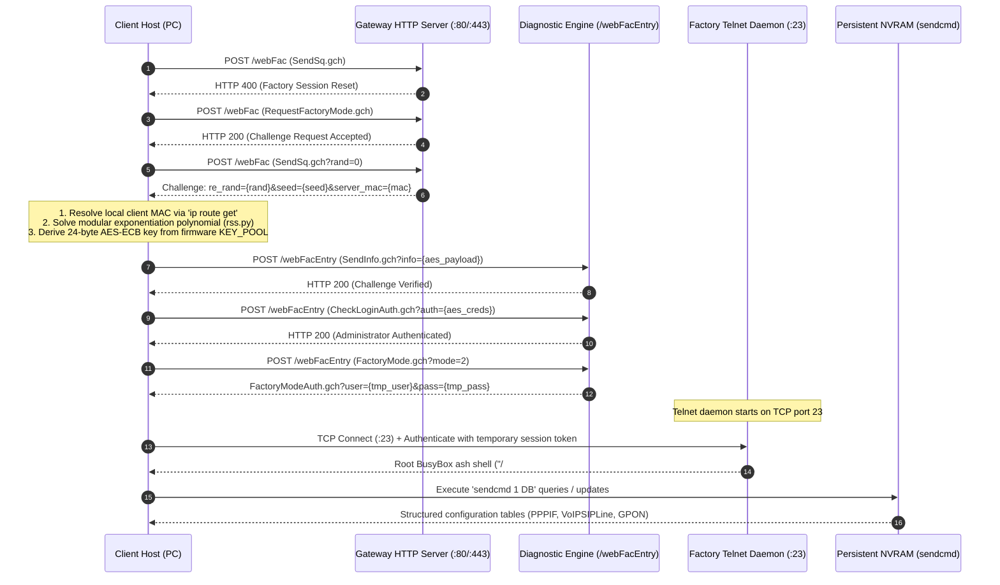

# ZTE ZXHN F670L Root & Management Toolkit

[](https://opensource.org/licenses/MIT)
[](#)
[](#)
[](https://www.python.org/)
[-orange.svg)](#)

A target-focused reverse-engineering, diagnostic, and automation toolkit for the **ZTE ZXHN F670L GPON Gateway** (Hardware Version V9.0, running firmware `V9.0.10P18N3D` and V9.0 variants, commonly deployed on Airtel Xstream Fiber and generic FTTH networks).

Provides tools to spawn an interactive root BusyBox ash shell via the factory diagnostic interface, extract provisioned credentials (PPPoE, VoIP SIP, GPON optical identifiers, Wi-Fi keys), query real-time gateway telemetry, and configure WAN Bridge Mode for external routers.

---

## ⚡ Quick Start

### 1. Installation

```bash
git clone https://github.com/rendlavenu/f670l-toolkit.git
cd f670l-toolkit
pip install -r requirements.txt
```

### 2. Spawn an Interactive Root Shell

```bash
./scripts/router_shell.py
```
*Prompts for web administrator credentials, solves the cryptographic factory handshake, and opens a root BusyBox ash shell (`/ # `).*

### 3. Extract Provisioned Credentials

```bash
# Print formatted human-readable credentials
./scripts/extract_credentials.py

# Export machine-readable JSON for automated provisioning
./scripts/extract_credentials.py --json > credentials.json
```
*Extracts plaintext PPPoE authentication, VoIP SIP credentials and SBC proxy addresses, GPON optical serial numbers (ASCII & Hex), SLID/PLOAM passwords, and Wi-Fi WPA2/WPA3 keys.*

### 4. Query Real-Time System Telemetry

```bash
# Gateway overview (CPU, RAM, optical power, uptime)
./scripts/router_ctl.py status

# Connected network clients (IP, MAC, hostname, RSSI)
./scripts/router_ctl.py who

# Wi-Fi radio configurations (SSID, channel, encryption)
./scripts/router_ctl.py wifi
```

### 5. Enable True WAN Bridge Mode

```bash
./scripts/enable_bridge.py --lan-port 4
```
*Binds WAN VLAN 100 directly to physical LAN Port 4 for external routers (pfSense, OPNsense, OpenWrt, UniFi).*

---

## 🎯 What Can Be Achieved (Key Use Cases)

This toolkit unlocks the full hardware capabilities of the ZTE F670L, resolving common ISP restrictions:

| Goal / Use Case | Why It's Needed | How It's Achieved | Documentation / Script |
| :--- | :--- | :--- | :--- |
| **True WAN Bridge Mode** | Eliminate Double NAT, bufferbloat, and allow your own router (pfSense, OPNsense, UniFi, OpenWrt) to dial PPPoE. | Binds WAN VLAN 100 directly to a designated Ethernet LAN port. | [`enable_bridge.py`](file:///home/broken/myWorld/f670l-toolkit/scripts/enable_bridge.py) |
| **Extract PPPoE Credentials** | ISPs do not provide PPPoE passwords in the web interface. | Dumps plaintext PPPoE username and password directly from flash NVRAM (`PPPIF`). | [`extract_credentials.py`](file:///home/broken/myWorld/f670l-toolkit/scripts/extract_credentials.py) |
| **VoIP / SIP Landline on Mobile / PBX** | Use your ISP landline number on softphones (Zoiper, Grandstream) or Asterisk/FreePBX without an analog phone. | Extracts SIP account ID, MD5 digest password, and regional IMS SBC proxy addresses. | [`docs/voip_sip.md`](file:///home/broken/myWorld/f670l-toolkit/docs/voip_sip.md) |
| **GPON ONT Cloning & SFP Migration** | Completely replace the ISP router with a third-party SFP stick (DFP-34X-2C2, Huawei MA5671A, CarlitoxxPro). | Extracts GPON Serial (ASCII & Hex), SLID / PLOAM password, LOID, and OMCI Equipment ID. | [`docs/gpon_cloning.md`](file:///home/broken/myWorld/f670l-toolkit/docs/gpon_cloning.md) |
| **Disable ISP Remote Overwrites (TR-069)** | Prevent ISP ACS servers from periodically resetting custom DNS, Wi-Fi, or Bridge Mode settings. | Disables the internal CWMP periodic inform client (`Tr069Cfg 0 Enable 0`). | [`docs/sendcmd_reference.md`](file:///home/broken/myWorld/f670l-toolkit/docs/sendcmd_reference.md) |
| **Unhide Web Menus & Elevate SuperAdmin** | Unlock hidden IPv6 DHCP, static routes, and advanced controls disabled in the Airtel web GUI. | Unhides GUI buttons (`UserIF 0 ExtraDwd 0`) and elevates web login to Level 1 SuperAdmin (`DevAuthInfo 1 Level 1`). | [`docs/sendcmd_reference.md`](file:///home/broken/myWorld/f670l-toolkit/docs/sendcmd_reference.md) |
| **Fix IPv6 DNS Leaks (Pi-hole / AdGuard)** | ISP firmware advertises ISP DNS over IPv6 RDNSS, bypassing local ad-blockers. | Decouples WAN IPv6 DNS and routes all gateway queries strictly to local Pi-hole addresses. | [`docs/sendcmd_reference.md`](file:///home/broken/myWorld/f670l-toolkit/docs/sendcmd_reference.md) |
| **CLI Telemetry & Fiber Health Monitoring** | Monitor optical receive power (Rx dBm), CPU/RAM load, and Wi-Fi RSSI without logging into the web GUI. | Real-time CLI telemetry and connected device discovery. | [`scripts/router_ctl.py`](file:///home/broken/myWorld/f670l-toolkit/scripts/router_ctl.py) |

---

## 📐 Architecture & Protocol Flow

The toolkit interacts with the gateway's undocumented factory diagnostic engine (`/webFac` and `/webFacEntry`) to initialize a root Telnet daemon on TCP port 23:



---

## 🛠 Toolset Reference

### 1. `router_shell.py` - Interactive Root Terminal
Establishes a raw PTY terminal connected to the gateway's BusyBox v1.17.2 ash shell.

```text
Usage:
  ./scripts/router_shell.py [OPTIONS]

Options:
  --host TEXT      Gateway IP address [default: 192.168.1.1 or $ROUTER_IP]
  --user TEXT      Web administrator username [default: $ROUTER_USER or prompt]
  --password TEXT  Web administrator password [default: $ROUTER_PASS or prompt]
```

### 2. `extract_credentials.py` - Credential Harvester
Queries the gateway database tables over the factory Telnet session and parses all active credentials.

```text
Usage:
  ./scripts/extract_credentials.py [OPTIONS]

Options:
  --host TEXT      Gateway IP address [default: 192.168.1.1]
  --user TEXT      Web administrator username
  --password TEXT  Web administrator password
  --json           Output raw machine-readable JSON to stdout
```

### 3. `router_ctl.py` - CLI Gateway Telemetry
Queries the authenticated web management interface to retrieve real-time diagnostic metrics.

```text
Usage:
  ./scripts/router_ctl.py [OPTIONS] {status|who|wifi}

Commands:
  status           Display gateway uptime, CPU load, RAM usage, and optical power (Rx/Tx)
  who              List connected Ethernet and Wi-Fi clients (IP, MAC, host, signal)
  wifi             Display radio settings (2.4GHz / 5GHz channels, SSIDs, security)
```

### 4. `enable_bridge.py` - WAN Bridge Mode Configurator
Reconfigures internal port mapping tables to bind WAN VLAN 100 directly to a designated Ethernet port.

```text
Usage:
  ./scripts/enable_bridge.py [OPTIONS]

Options:
  --lan-port INT   Physical LAN port to bridge [1-4, default: 4]
  --host TEXT      Gateway IP address [default: 192.168.1.1]
```

---

## 🗄 Low-Level Database Reference (`sendcmd 1 DB`)

Inside the root shell (`/ # `), use the internal `sendcmd 1 DB` utility to query or configure flash tables directly:

```bash
# Read configuration tables:
sendcmd 1 DB p PPPIF          # PPPoE authentication username & password
sendcmd 1 DB p VoIPSIPLine     # VoIP telephone number & SIP password
sendcmd 1 DB p VoIPSIPServer   # SIP Registrar & Outbound Proxy SBC
sendcmd 1 DB p GPON            # GPON Serial Number & PLOAM/SLID password
sendcmd 1 DB p WLANBase        # Wi-Fi SSIDs, passwords, and radio channels
sendcmd 1 DB p PortControl     # Physical port binding matrix
sendcmd 1 DB p DevInfo         # Hardware serial & software version

# Commit changes to persistent flash storage (MANDATORY):
sendcmd 1 DB save
```

> [!IMPORTANT]
> Any modifications made via `sendcmd 1 DB set ...` reside strictly in volatile RAM. If the gateway reboots before you execute `sendcmd 1 DB save`, all changes are discarded.

---

## 🔧 Diagnostics & Troubleshooting

| Symptom / Error | Root Cause | Resolution |
| :--- | :--- | :--- |
| `Connection refused` / `Timeout` on port 80/443 | Host PC is not on the same subnet as the gateway. | Connect via Ethernet directly to LAN ports 1–3 or Wi-Fi. Ensure host IP is in `192.168.1.0/24`. |
| `Step 4 CheckLoginAuth failed: 401` | Incorrect web administrator credentials or concurrent session lock. | Log out of the web interface in your browser, wait 10 seconds, and retry. |
| `local mismatch` in `rss.py` | Client MAC detection did not match the interface routing to the gateway. | The toolkit uses `ip route get <target>` dynamically. If running in a container, ensure `--net=host` is used. |
| Telnet port 23 unreachable after handshake | Factory session was closed prematurely or conflicting session is open. | Re-run `router_shell.py`; the script executes a mandatory factory reset (`SendSq.gch`) before negotiating. |
| Settings revert after gateway reboot | `sendcmd 1 DB save` was not executed, or TR-069 ACS pushed carrier defaults. | Run `sendcmd 1 DB save` after all modifications. To block ACS overrides, disable TR-069 via `sendcmd 1 DB set Tr069Cfg 0 Enable 0 && sendcmd 1 DB save`. |

---

## 📁 Repository Structure

```text
f670l-toolkit/
├── README.md                  # System documentation & usage instructions
├── LICENSE                    # MIT Open Source License
├── requirements.txt           # Python library dependencies (requests, pycryptodome)
├── AGENT.md                   # AI Assistant architectural invariants & domain guidelines
├── CLAUDE.md                  # Symlink to AGENT.md
├── lib/
│   ├── zte_unlock.py          # /webFac challenge-response & AES key derivation
│   └── rss.py                 # Modular exponentiation solver (verify_do_check_client)
├── scripts/
│   ├── router_shell.py        # Interactive root BusyBox terminal connector
│   ├── extract_credentials.py # Automated credential extraction tool
│   ├── router_ctl.py          # Command-line status, telemetry & client discovery
│   └── enable_bridge.py       # Automated WAN Bridge Mode configurator
└── docs/
    ├── root_access.md         # /webFac protocol & cryptographic analysis
    ├── voip_sip.md            # VoIP VLAN architecture & softphone setup
    ├── gpon_cloning.md        # Optical serial provisioning & third-party SFP guide
    └── sendcmd_reference.md   # Internal NVRAM database manipulation reference
```

---

## ⚖️ Legal, Regulatory, and Safety Disclaimers

### 1. Authorized Personal Use & Legal Notice
This software is provided strictly for diagnostic, administrative, interoperability, and educational purposes on customer premises equipment (CPE) that you personally own or have explicit authorization to administer.
* **United States**: Accessing computer systems without authorization or exceeding authorized access is governed by the *Computer Fraud and Abuse Act (CFAA), 18 U.S.C. § 1030*.
* **India**: Unauthorized access or tampering with computer systems is governed by the *Information Technology Act, 2000 (Sections 43 and 66)*.
* **International**: Users are solely responsible for ensuring compliance with all local laws and telecommunications regulations in their respective jurisdictions before deploying this toolkit.

### 2. Statutory Interoperability & Research Exceptions
This reverse-engineering research and documentation has been performed strictly to enable device interoperability, hardware analysis, and customer data extraction under applicable fair-use and statutory exemptions:
* **European Union**: *Directive 2009/24/EC, Article 6* (Decompilation strictly for interoperability).
* **United States**: *17 U.S.C. § 1201(f)* (Reverse engineering for the purpose of achieving interoperability).
* **India**: *Indian Copyright Act, 1957, Section 52(1)(ab)* (Observation, study, or testing of computer program functioning).

### 3. Telecommunications & ISP Terms of Service
Customer premises gateways provided by Internet Service Providers (ISPs) under subscription contracts remain subject to the provider's Subscriber Terms and Conditions. Modifying internal gateway settings, disabling remote management (TR-069), or replacing the provider-issued ONT with third-party hardware may violate your service agreement, invalidate hardware warranties, or prompt the service provider to suspend optical service. The authors and contributors of this repository bear no affiliation with Bharti Airtel, ZTE Corporation, or any affiliated telecommunications provider.

### 4. Optical Laser Radiation Hazard
Broadband fiber connections utilize Class 1 / Class 1M infrared laser emitters operating at nominal wavelengths of 1310 nm and 1490 nm. This laser radiation is completely invisible to human vision. **Never look directly into the end of an optical fiber connector, optical patch cable, or transceiver port.** Unprotected exposure can cause rapid, severe, and permanent retinal injury.

### 5. Emergency Telephony Notice (112 / 911 / E911)
Extracted SIP voice credentials routed through custom softphone clients or third-party PBX installations must **NOT** be relied upon as the primary emergency calling mechanism. Emergency dispatcher routing relies on physical line identification tied to the carrier-provisioned gateway. Always ensure access to an alternative, verified communications channel for emergency services.

### 6. Limitation of Liability & No Warranty
THE SOFTWARE IS PROVIDED "AS IS", WITHOUT WARRANTY OF ANY KIND, EXPRESS OR IMPLIED, INCLUDING BUT NOT LIMITED TO THE WARRANTIES OF MERCHANTABILITY, FITNESS FOR A PARTICULAR PURPOSE, AND NONINFRINGEMENT. IN NO EVENT SHALL THE AUTHORS OR COPYRIGHT HOLDERS BE LIABLE FOR ANY CLAIM, DAMAGES, OR OTHER LIABILITY, WHETHER IN AN ACTION OF CONTRACT, TORT, OR OTHERWISE, ARISING FROM, OUT OF, OR IN CONNECTION WITH THE SOFTWARE OR THE USE OR OTHER DEALINGS IN THE SOFTWARE.
