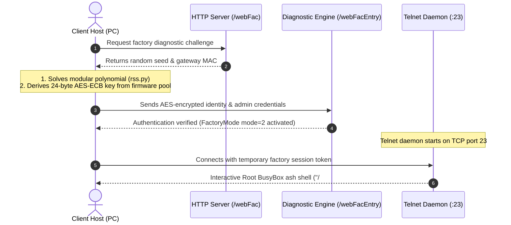

# ZTE ZXHN F670L Root Access & Telnet Unlocker

[](https://opensource.org/licenses/MIT)
[](#)
[](#)
[-red.svg)](#)

A reverse-engineered root exploit and automation toolkit for the **ZTE ZXHN F670L GPON Gateway** (Hardware V9.0, firmware `V9.0.10P18N3D` and V9.0 variants, commonly deployed on Airtel Xstream Fiber).

Exploits the hidden factory diagnostic interface (`/webFac`) to spawn an interactive **root BusyBox ash shell (`/ # `)** on Telnet port 23—allowing you to eliminate carrier IPv6 DNS leaks, extract plaintext credentials (PPPoE, VoIP SIP, GPON SN), and configure true WAN Bridge Mode.

> **Why this exists**: It began with eliminating carrier IPv6 DNS leaks that bypassed local network resolvers (Pi-hole/AdGuard) with no web UI toggle to disable them. Gaining root access via `/webFac` solved that leak at the source, and naturally opened up raw credential extraction, true Bridge Mode, and persistent firmware controls.

---

## ⚡ Gaining Root Access

### 1. Install Dependencies
```bash
git clone https://github.com/rendlavenu/zte-f670l-toolkit.git
cd zte-f670l-toolkit
pip install -r requirements.txt
```

### 2. Spawn Root Shell
```bash
./scripts/router_shell.py
```
*Automatically solves the modular exponentiation challenge, derives the AES-128-ECB session key, authenticates web credentials (`admin:admin`), elevates the factory session, and connects you to a root terminal:*

```text
[*] Solved factory handshake & derived AES session key.
[*] FactoryMode mode=2 elevated. Telnet port 23 active.
[*] Connecting to telnet session...

BusyBox v1.17.2 (2025-06-27) built-in shell (ash)
Enter 'help' for a list of built-in commands.

/ # 
```

---

## 📐 How the Root Unlock Works



---

## 🛠 What Root Access Enables

With root shell access (`uid=0`), you can directly manipulate the router's internal database (`sendcmd 1 DB`) or run the included automated scripts:

### 1. Extract Locked Credentials
```bash
./scripts/extract_credentials.py [--json]
```
Dumps plaintext **PPPoE** credentials, **VoIP SIP** passwords and SBC proxies, **GPON Serial Numbers** (ASCII & Hex), SLID/PLOAM tokens, and Wi-Fi pre-shared keys directly from flash NVRAM.

### 2. Enable True WAN Bridge Mode
```bash
./scripts/enable_bridge.py --lan-port 4
```
Binds WAN VLAN 100 directly to physical LAN Port 4, allowing third-party routers (pfSense, OPNsense, UniFi, OpenWrt) to dial PPPoE without Double NAT.

### 3. Direct NVRAM Control (`sendcmd 1 DB`)
```bash
sendcmd 1 DB p PPPIF          # View PPPoE account
sendcmd 1 DB p VoIPSIPLine     # View VoIP SIP credentials
sendcmd 1 DB p GPON            # View optical serial & PLOAM
sendcmd 1 DB set DevAuthInfo 1 Level 1  # Elevate web user to SuperAdmin
sendcmd 1 DB save              # Commit in-memory changes to SPI flash
```

---

## 📚 Deep Technical Documentation

Detailed protocol breakdowns and configuration walk-throughs are located in [`docs/`](docs/):

* **[`docs/root_access.md`](docs/root_access.md)**: Cryptographic reverse-engineering of `/webFac`, `do_check_client` polynomial math, and AES key derivation.
* **[`docs/router_hardening.md`](docs/router_hardening.md)**: Stop IPv6 DNS leaks (Pi-hole), block carrier firmware overwrites, neutralize 3 AM reboots, and free 16 MB RAM.
* **[`docs/voip_sip.md`](docs/voip_sip.md)**: Route extracted landline SIP credentials through smartphone softphones (Zoiper) or Asterisk PBX.
* **[`docs/gpon_cloning.md`](docs/gpon_cloning.md)**: Clone optical serial numbers onto third-party SFP ONT sticks to eliminate the ISP gateway entirely.
* **[`docs/sendcmd_reference.md`](docs/sendcmd_reference.md)**: Full reference table of internal configuration tables and database operations.

---

## ⚠️ Essential Invariants

1. **Commit Changes**: Modifications made via `sendcmd 1 DB set ...` reside in RAM. You must run `sendcmd 1 DB save` to persist across reboots.
2. **Subnet**: Host PC must be directly connected via LAN 1–3 or Wi-Fi on `192.168.1.0/24`.
3. **Carrier Overwrites**: To stop ISP ACS servers from undoing your changes, disable TR-069 via `sendcmd 1 DB set Tr069Cfg 0 Enable 0 && sendcmd 1 DB save`.

---

## ⚖️ Legal & Safety Disclaimer

> [!WARNING]
> * **Authorized Personal Use**: Strictly for diagnostics, security research, and personal equipment administration on hardware you own or have explicit authorization to test (compliant with CFAA, Indian IT Act 2000, and statutory interoperability exemptions).
> * **Laser Hazard**: Fiber optic lines use Class 1 invisible infrared lasers. Never look directly into optical ports or fiber patch cables.
> * **No Warranty**: Provided "AS IS" under the MIT License without liability for ISP terms violations or hardware misconfiguration.
