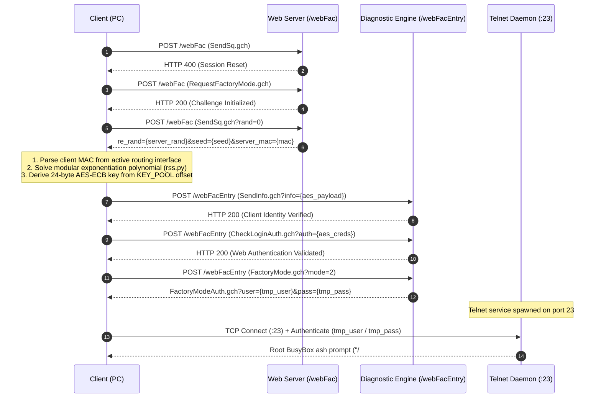

# ZTE ZXHN F670L Root Access Technical Analysis

**Target Hardware**: ZTE ZXHN F670L GPON Gateway (Hardware Version V9.0)  
**Target Firmware**: `V9.0.10P18N3D` (Build: June 27, 2025) and compatible V9.0 variants  
**Architecture**: Sanechips / ZTE ZX279128S (Dual-Core ARMv7 Cortex-A9, Linux 4.1.25)

---

> [!IMPORTANT]
> **Authorization & Compliance**: This documentation is provided for interoperability research, device administration, and security analysis on privately owned hardware. Execute these procedures only on hardware you are legally authorized to test.

---

## 1. Authentication Architecture: The `/webFac` Interface

ZTE gateway firmware includes a proprietary diagnostic interface exposed through `/webFac` and `/webFacEntry`. Designed for factory production and automated bench diagnostics, these endpoints validate client identity through a challenge-response handshake before elevating privileges and initiating a local Telnet daemon on TCP port 23.

### Cryptographic Handshake Protocol Flow

---

## 2. Cryptographic Handshake Specification

### A. Modular Exponentiation Solver (`lib/rss.py`)
In the gateway `httpd` binary, the internal function `do_check_client` verifies that the submitted client data buffer contains a valid transform matching both the client interface MAC and the gateway MAC:

$$\text{work\_buffer}[i] = (\text{client\_data}[i])^e \pmod m$$

Where the exponent $e$ and modulus $m$ are derived through polynomial exponentiation over the seed:
$$P(x) = x^{0x1687} \pmod{0x7561}$$

The solver computes inverse operations to construct a 40-byte client token that satisfies `verify_do_check_client`.

### B. AES-128-ECB Key Derivation
All subsequent payloads sent to `/webFacEntry` are encrypted using AES in ECB mode. The 24-byte encryption key is derived dynamically from an internal 88-byte firmware key pool (`KEY_POOL`):

$$\text{offset} = (\text{client\_mac} \oplus \text{server\_mac}) \pmod{60}$$
$$\text{key}[i] = \text{KEY\_POOL}[\text{offset} + i] \oplus \text{0xA5}$$

---

## 3. Session Lifespan & Security Invariants

1. **Temporary Session Credentials**: The Telnet username (e.g. `9nU5kSEx`) and password returned by `FactoryMode.gch?mode=2` are dynamically generated per factory session.
2. **Telnet Port Lifecycle**: Port 23 remains listening until the factory session is explicitly terminated (`FactoryMode.gch?mode=0`) or the gateway reboots.
3. **Database Write Invariant**: Commands executed via `sendcmd 1 DB set ...` operate exclusively on the in-memory SQLite/NVRAM runtime cache. Changes **do not persist across reboot** unless explicitly saved to flash via `sendcmd 1 DB save`.
